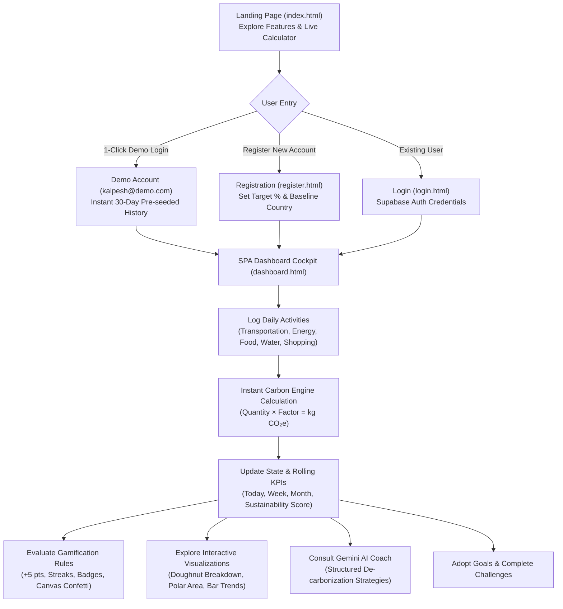

# Product Requirements Document (PRD)

**Product Name:** EcoTrack — Intelligent Sustainability Assistant & Carbon Tracker  
**Repository:** `Intelligent Sustainability Assistant and Carbon Tracker`  
**Live Production URL:** [https://ecotrack-app-peach.vercel.app/](https://ecotrack-app-peach.vercel.app/)  
**Version:** 1.0.0 (Production Release)  
**Status:** Implemented, Verified & Live in Production  
**Date:** October 2026  
**Primary Tech Stack:** Vanilla JavaScript (ES6+ Modules), HTML5, CSS3 Custom Design Tokens, Vite 5.4, Chart.js 4.4, Supabase (PostgreSQL 17 & Edge Functions), Google Gemini API  

---

## 1. Executive Summary & Product Vision

### 1.1 Problem Statement
Modern individuals are increasingly conscious of climate change and environmental degradation, yet taking tangible personal action remains difficult:
- **Calculation Complexity:** Carbon accounting methodology is opaque, fragmented, and typically requires complex formulas and unfamiliar scientific emission coefficients.
- **Lack of Actionable Guidance:** Generic advice ("use less energy") fails to connect personal daily choices with specific emission reductions.
- **Engagement Drop-off:** Without immediate visual feedback, milestones, and habit-forming feedback loops, users quickly abandon carbon tracking.
- **Privacy & Tooling Friction:** Many platforms require mandatory invasive registrations or lack offline responsiveness.

### 1.2 Product Vision
**EcoTrack** is an intelligent, accessible, and full-featured personal carbon tracking and sustainability cockpit. It bridges validated environmental science with modern web technology by providing:
1. **Scientifically Rigorous Calculations:** Instant greenhouse gas ($\text{kg CO}_2\text{e}$) estimates calculated from validated IPCC, EPA, DEFRA, and Our World in Data emission factors.
2. **Dynamic Period Visualizations:** Interactive Chart.js analytics across rolling windows (7 days, 30 days, 90 days, 1 year).
3. **Personalized Gemini AI Coaching:** Actionable, non-judgmental reduction advice generated from privacy-safe behavioral summaries and enforced with structured JSON schemas.
4. **Behavioral Gamification:** Real-time streak tracking, point bounties, multi-tier badges, and HTML5 canvas confetti celebrations.
5. **Hybrid Local & Cloud Persistence:** Instant out-of-the-box exploration via an isolated multi-account client store and pre-seeded demo dataset, seamlessly backed by Supabase PostgreSQL and Row Level Security (RLS).

---

## 2. Target Users & Personas

| User Persona | Profile & Goals | Key Needs in EcoTrack |
| :--- | :--- | :--- |
| **Sustainability Beginner** | Students or young professionals starting an eco-friendly lifestyle. | Fast, intuitive logging with common daily activities (commute, diet, utilities) and immediate impact feedback. |
| **Active Decarbonizer** | Environmentally conscious users committed to measurable footprint reductions. | Multi-period analytics, category breakdown charts, custom reduction goals, and progress tracking. |
| **Habit Builder** | Users motivated by streaks, gamified progression, and achievement unlocks. | Daily logging streak counters, point incentives, badge milestones, and celebration feedback. |
| **Evaluator / Demo User** | Reviewers, assessors, or prospective users wanting instant app exploration. | 1-click rich demo account (`kalpesh@demo.com`) pre-loaded with realistic 30-day activity histories and active goals. |

---

## 3. Core User Journey



---

## 4. Technical Architecture & Tech Stack

### 4.1 Technology Blueprint

```text
┌────────────────────────────────────────────────────────────────────────┐
│                               CLIENT BROWSER                           │
│  ┌──────────────────────────────────────────────────────────────────┐  │
│  │ HTML5 Semantic Layout  │  CSS3 Variables (Dark/Light Theme)     │  │
│  └──────────────────────────────────────────────────────────────────┘  │
│  ┌──────────────────────────────────────────────────────────────────┐  │
│  │ Vanilla JavaScript ES6+ Modules (Bundled & Served via Vite 5.4)   │  │
│  │  ├── app.js (Master UI Controller & View Router)                 │  │
│  │  ├── store.js (Reactive Multi-Account Client State Store)        │  │
│  │  ├── calculator.js & emissionFactors.js (IPCC Calculation Engine)│  │
│  │  ├── charts.js (Chart.js 4.4 Engine: Doughnut, Polar Area, Bar)  │  │
│  │  ├── gamification.js (Streaks, Points & Badges Engine)           │  │
│  │  ├── aiCoach.js (Gemini Client Payload Builder & Validator)      │  │
│  │  ├── auth.js (Authentication Controller)                         │  │
│  │  └── supabaseSync.js (Optimistic Cloud Synchronization Layer)    │  │
│  └──────────────────────────────────────────────────────────────────┘  │
└───────────────────────────────────┬────────────────────────────────────┘
                                    │ HTTPS (API / Auth / Sync)
                                    ▼
┌────────────────────────────────────────────────────────────────────────┐
│                          SUPABASE BACKEND CLOUD                        │
│  ┌──────────────────────────────────────────────────────────────────┐  │
│  │ Supabase Auth (Email / Password Sessions)                        │  │
│  ├──────────────────────────────────────────────────────────────────┤  │
│  │ PostgreSQL 17 Database with Row Level Security (RLS)             │  │
│  │  • profiles            • activity_logs     • emission_factors    │  │
│  │  • goals               • challenges        • user_challenges     │  │
│  │  • achievements        • user_achievements • ai_recommendations │  │
│  ├──────────────────────────────────────────────────────────────────┤  │
│  │ Supabase Edge Functions (Deno Runtime)                           │  │
│  │  └── generate-recommendations/ (Secure Gemini Proxy)             │  │
│  └────────────────────────────────┬─────────────────────────────────┘  │
└───────────────────────────────────┼────────────────────────────────────┘
                                    │ Server-Side Secret GEMINI_API_KEY
                                    ▼
┌────────────────────────────────────────────────────────────────────────┐
│                           GOOGLE GEMINI API                            │
│  └── Structured JSON Generation (decarbonization coaching)             │
└────────────────────────────────────────────────────────────────────────┘
```

### 4.2 Stack Specification
- **Frontend Core:** Vanilla JavaScript (ES6+ Native Modules), HTML5, CSS3 Custom Properties.
- **Bundler & Dev Server:** Vite 5.4.
- **Data Visualizations:** Chart.js 4.4 (Canvas-rendered Doughnut, Polar Area, Bar, and Line charts).
- **Celebration Effects:** Canvas Confetti (zero external runtime dependency, pure canvas particle physics).
- **Database & Auth:** Supabase PostgreSQL 17 with strict Row Level Security (RLS) policies and triggers.
- **Serverless AI Gateway:** Supabase Edge Functions (Deno runtime) proxying calls to Google Gemini API with zero client-side key exposure.
- **Persistence Architecture:** Dual-mode hybrid architecture:
  - Client-side isolated multi-account LocalStorage (`ecotrack_account_<email>`).
  - Optimistic background cloud sync with retry queue (`supabaseSync.js`).

---

## 5. Application Structure & Page Blueprints

The application follows a clean multi-page entry structure combined with a comprehensive Single-Page Application (SPA) dashboard cockpit:

### 5.1 Landing Page (`frontend/index.html`)
Public-facing product showcase:
- **Hero Section:** Value proposition headline, high-impact subtitle, CTA buttons ("Launch Dashboard", "Live Preview").
- **Live Interactive Carbon Calculator Demo:** Real-time preview allowing visitors to compute emission impacts across Transport, Energy, and Food without logging in.
- **Feature Showcase:** Deep dives into the IPCC calculation engine, Gemini AI Coach, Chart.js analytics, and Gamification.
- **How It Works:** Step-by-step 3-stage user flow (Log Activity $\rightarrow$ View Insights $\rightarrow$ Cut Footprint).
- **Theme Switcher:** Dark/Light mode toggle with instant persistence in `localStorage`.

### 5.2 Authentication Portals (`login.html` & `register.html`)
- **Login Portal (`login.html`):**
  - Supabase email/password authentication with session persistence.
  - **1-Click Demo Login (`kalpesh@demo.com`):** Instantly pre-fills and enters the live interactive demo cockpit.
  - Password show/hide toggle, input validation, and automatic offline fallback.
- **Registration Portal (`register.html`):**
  - New user sign-up with full name, email, and password confirmation.
  - Onboarding preference selectors: Country (default India), Baseline Reduction Target (10%, 20%, 30%).
  - Automatic provisioning of isolated account state with 3 fresh starter goals.

### 5.3 Unified Dashboard Cockpit (`frontend/dashboard.html`)
The core operational cockpit provides a responsive sidebar navigation shell hosting 6 tabbed views:

```text
dashboard.html
├── Header & Sidebar Shell (Collapsible Nav, Theme Toggle, User Avatar & Streak Pill)
├── View 1: Dashboard Overview (KPI stat pills, weekly trend, category doughnut, quick-logger)
├── View 2: Activities History (Full filterable activity log, category pills, keyword search, date picker, delete modal)
├── View 3: Analytics & Trends (7D/30D/90D/1Y filters, Polar Area chart, top contributors)
├── View 4: Goals & Challenges (Active reduction targets, habit challenges, claim bounties)
├── View 5: AI Sustainability Coach (Gemini prompt cards, priority pills, actionable advice)
└── View 6: Profile & Preferences (User units, reduction target, account reset)
```

---

## 6. Functional Requirements

### 6.1 Multi-Category Emission Calculation Engine

#### 6.1.1 Calculation Formula
$$\text{Calculated Emissions } (\text{kg CO}_2\text{e}) = \text{Activity Quantity} \times \text{Emission Factor}$$

#### 6.1.2 Emission Factors Repository (`emissionFactors.js`)
All factors are strictly referenced from IPCC, EPA, DEFRA 2023, and Our World in Data peer-reviewed datasets:

| Category | Activity Identifier | Activity Type | Unit | Factor ($\text{kg CO}_2\text{e}$/unit) | Source Benchmark |
| :--- | :--- | :--- | :--- | :--- | :--- |
| **Transportation** | `ef_trans_car_petrol` | Car (Petrol / Gasoline) | km | `0.21` | DEFRA 2023 / EPA |
| **Transportation** | `ef_trans_car_diesel` | Car (Diesel) | km | `0.18` | DEFRA 2023 |
| **Transportation** | `ef_trans_car_ev` | Electric Vehicle (EV) | km | `0.05` | IEA Grid Avg |
| **Transportation** | `ef_trans_bus` | City Bus / Public Transit | km | `0.08` | EPA Transit |
| **Transportation** | `ef_trans_train` | Train / Metro / Subway | km | `0.04` | DEFRA Rail |
| **Transportation** | `ef_trans_flight_domestic`| Flight (Domestic / Short-Haul)| km | `0.25` | ICAO / DEFRA |
| **Transportation** | `ef_trans_flight_long` | Flight (Long-Haul >3700 km) | km | `0.15` | ICAO / DEFRA |
| **Transportation** | `ef_trans_motorbike` | Motorcycle / Scooter | km | `0.11` | DEFRA 2023 |
| **Energy** | `ef_energy_grid` | Grid Electricity | kWh | `0.42` | EIA / IEA |
| **Energy** | `ef_energy_gas` | Natural Gas (Heating/Cooking) | kWh | `0.20` | EPA GHG Factors |
| **Energy** | `ef_energy_heating_oil` | Heating Oil | L | `2.70` | DEFRA Fuel |
| **Energy** | `ef_energy_solar` | Rooftop Solar | kWh | `0.02` | NREL Lifecycle |
| **Food** | `ef_food_beef` | Beef Meal | meals| `6.50` | Poore & Nemecek (Science) |
| **Food** | `ef_food_chicken` | Poultry / Chicken Meal | meals| `1.80` | Our World in Data |
| **Food** | `ef_food_pork` | Pork Meal | meals| `2.20` | Our World in Data |
| **Food** | `ef_food_vegetarian` | Vegetarian Meal (Dairy/Eggs) | meals| `0.90` | Oxford Food Study |
| **Food** | `ef_food_vegan` | 100% Plant-Based / Vegan Meal| meals| `0.50` | Oxford Food Study |
| **Food** | `ef_food_dairy_milk` | Dairy Milk | L | `1.20` | Poore & Nemecek |
| **Water** | `ef_water_shower` | Hot Shower (8-10 min) | showers| `0.85` | Waterwise / Carbon Trust |
| **Water** | `ef_water_tap` | Tap Water Supply | L | `0.0003`| UK Water Industry |
| **Water** | `ef_water_bottled` | Bottled Water (Plastic 500ml) | bottles| `0.16` | Beverage Council |
| **Shopping** | `ef_shop_clothing` | Clothing / Apparel Item | items| `8.50` | WRAP UK / Textile Exch. |
| **Shopping** | `ef_shop_smartphone` | New Smartphone | units| `60.00` | Apple / Fairphone Env. |
| **Shopping** | `ef_shop_laptop` | New Laptop Computer | units| `200.00`| Dell / HP Disclosures |
| **Shopping** | `ef_shop_general` | General Consumer Goods | kg | `2.50` | EPA WARM Model |

#### 6.1.3 Logging Requirements
- Input quantity must be numeric and strictly $> 0$.
- Dynamic unit rendering according to the selected activity.
- Real-time live estimate calculation shown to user prior to submission.
- Immutable calculation snapshot: logs preserve `emissionFactorId`, quantity, date, unit, and calculated $\text{kg CO}_2\text{e}$ at creation time.
- Optional imperial toggle: values can be viewed in pounds ($\text{lbs CO}_2\text{e}$) via profile preference ($\text{lbs} = \text{kg} \times 2.20462$).

---

### 6.2 Dynamic Analytics & Visualization Engine

#### 6.2.1 KPI Dashboard Counters
- **Today's Emissions:** Sum of activities logged with today's date.
- **This Week's Emissions:** Rolling 7-day cumulative emissions.
- **This Month's Emissions:** Rolling 30-day cumulative emissions.
- **Sustainability Score:** Dynamic metric between 0 and 100 evaluated based on activity logging frequency, progress towards reduction targets, and streak consistency.
- **Cubic-Bezier Counter Animations:** Universal `animateValue()` easing (`easeOutCubic`) smoothly animates KPI numbers from initial to calculated values over 650ms.

#### 6.2.2 Chart Visualizations (`charts.js`)
- **Category Doughnut Chart:** Breakdown of emission shares across Transportation, Energy, Food, Water, and Shopping.
- **Trend Chart:** Rolling daily/weekly emission trajectory comparing current vs target thresholds.
- **Polar Area Distribution Chart:** High-resolution multi-dimensional distribution in the Analytics view.
- **Filter Ranges:** Instant switching between 7 Days (`7d`), 30 Days (`30d`), 90 Days (`90d`), and 1 Year (`1y`).
- **Top Contributors Breakdown:** Ranked descending list of highest carbon-producing individual activities.

---

### 6.3 Gamification & Behavioral Change Engine

#### 6.3.1 Eco Points Configuration (`POINTS_CONFIG`)
```javascript
export const POINTS_CONFIG = {
  ACTIVITY_LOGGED: 5,        // +5 Eco Points per logged activity
  CHALLENGE_COMPLETED: 50,   // +50 Eco Points per challenge completed
  SEVEN_DAY_STREAK: 30,      // +30 Eco Points bonus for 7-day streak
  GOAL_ACHIEVED: 100         // +100 Eco Points for completing a goal
};
```

#### 6.3.2 Strict Streak Tracking Engine
- Evaluates timestamp of user's most recent activity against current date.
- Enforces a 24-48 hour logging window. Consecutive calendar days increment the streak counter.
- If more than 1 calendar day elapses without activity, the streak resets to 1 upon the next log.

#### 6.3.3 Achievements & Badges (`evaluateAchievements`)
- **First Step (`ach_01`):** Logged first carbon activity (+20 points).
- **Transit Champion (`ach_02`):** Logged at least 5 public transit or train trips (+50 points).
- **Streak Master (`ach_03`):** Reached a 7-day continuous logging streak (+100 points).
- **Eco Legend (`ach_05`):** Accumulated 500+ lifetime Eco Points (+150 points).

#### 6.3.4 Confetti Celebration Physics (`launchConfetti`)
- Zero external package dependency; pure HTML5 canvas particle simulation (`#confettiCanvas`).
- Renders 70 multi-colored particles bursting with randomized velocity vectors, gravity, and drag upon unlocking an achievement badge or completing a sustainability challenge.

---

### 6.4 Google Gemini AI Sustainability Coach

#### 6.4.1 Privacy-Preserving Summarization (`buildActivitySummaryPayload`)
To prevent PII leakage and protect user confidentiality, client code summarizes activity data into a compact numerical payload before invoking the AI:

```json
{
  "period": "last_30_days",
  "total_co2_kg": 185.4,
  "categories": {
    "transportation": 82.1,
    "energy": 51.3,
    "food": 32.5,
    "water": 7.5,
    "shopping": 12.0
  },
  "top_activities": [
    {"activity": "Car (Petrol / Gasoline)", "co2_kg": 64.2},
    {"activity": "Grid Electricity", "co2_kg": 48.7}
  ],
  "recent_trend": "increasing"
}
```

#### 6.4.2 Structured JSON Response Schema & Validation (`validateGeminiResponse`)
The Gemini integration strictly enforces a structured JSON response schema:

```json
{
  "summary": "Your transportation footprint is the primary driver of this month's 185.4 kg CO2e.",
  "overall_priority": "high",
  "recommendations": [
    {
      "title": "Transition 2 Weekly Commutes to Rail or Bus",
      "category": "transportation",
      "priority": "high",
      "reason": "Gasoline car travel accounted for 64.2 kg CO2e of your total footprint.",
      "action": "Swap two solo car commutes per week with metro transit or carpooling.",
      "estimated_impact_kg_co2_per_month": 24.5,
      "difficulty": "easy"
    }
  ]
}
```

- **Validation Rules:**
  - `summary`: Non-empty string.
  - `overall_priority`: Must be one of `"low"`, `"medium"`, `"high"`.
  - `recommendations`: Non-empty array with valid `category` (`transportation`, `energy`, `food`, `water`, `shopping`), `priority` (`low`, `medium`, `high`), `difficulty` (`easy`, `medium`, `hard`), and positive `estimated_impact_kg_co2_per_month`.
- **Server-Side Edge Proxy:** Client calls Supabase Edge Function `generate-recommendations` which accesses `GEMINI_API_KEY` exclusively server-side. Zero secret leakage to the browser.
- **Client Fallback:** If offline or the Edge Function is unconfigured, an adaptive client-side rule engine generates validated structured recommendations based on the user's top emission category.

---

### 6.5 Hybrid State Persistence & Multi-Account Architecture

#### 6.5.1 Isolated Multi-Account Local Engine (`store.js`)
- Each account is namespaced in localStorage under `ecotrack_account_<email>`.
- **Pre-Seeded Demo Profile (`kalpesh@demo.com`):** Includes 30 days of realistic pre-populated activity data, active goals (commute cuts, home energy conservation, plant-forward diet), challenges, badges, and an existing streak for immediate demonstration.
- **New User Accounts:** Created with clean zero-progress baselines, customized reduction target %, and 3 tailored starter goals.

#### 6.5.2 Supabase PostgreSQL Cloud Schema & Sync (`supabaseSync.js`)
- PostgreSQL 17 schema defined in `backend/database/schema.sql`.
- Tables:
  1. `profiles`: User metadata, points, streaks, preferred unit, reduction target.
  2. `emission_factors`: Master factor registry with validity periods and sources.
  3. `activity_logs`: Timestamped emission records with factor snapshots and kg CO₂e.
  4. `goals`: User reduction targets and percentage progress.
  5. `challenges` & `user_challenges`: Global challenges and per-user adoption state.
  6. `achievements` & `user_achievements`: Master badge definitions and unlock dates.
  7. `ai_recommendations`: Persisted Gemini recommendations per user.
- **Row Level Security (RLS):** Enabled across all user-owned tables, enforcing `auth.uid() = user_id`.
- **Optimistic Sync Layer:** Background synchronization queue (`supabaseSync.js`) reconciles local state with PostgreSQL whenever Supabase credentials are configured.

---

### 6.6 Design System & Theme Engine

- **Emerald Sustainability Theme Tokens:**
  - Primary: `#059669` (Emerald 600)
  - Primary Dark: `#047857` (Emerald 700)
  - Accent: `#10b981` (Emerald 500)
  - Dark Surface: `#0f172a` (Slate 900) / Background: `#020617` (Slate 950)
  - Light Surface: `#ffffff` / Background: `#f8fafc` (Slate 50)
- **Zero-FOUC Theme Switcher:** Inline head execution script checks `localStorage.getItem("ecotrack_theme")` and system `prefers-color-scheme` prior to DOM render, preventing theme flash.
- **Mobile-First Responsive Layout:** Adaptive from 320px smartphones to 4K displays; collapsible sidebar, modal drawers, and responsive Chart.js canvases.

---

## 7. Non-Functional Requirements

| Dimension | Specification | Implementation Detail |
| :--- | :--- | :--- |
| **Performance** | Sub-second First Contentful Paint (<800ms); 60 FPS transitions. | Vanilla JavaScript with zero heavy framework runtime overhead; Vite bundling; `requestAnimationFrame` interpolation. |
| **Offline Resilience** | Full application functionality without an active server or internet connection. | Dual-mode state architecture; automatic fallback to local multi-account store with pre-seeded demo. |
| **Security & Privacy** | Strict isolation between user accounts; zero AI credential leakage. | Supabase RLS (`auth.uid()`); server-side Edge Function proxy for Gemini; privacy-safe activity aggregation. |
| **Accessibility** | WCAG 2.1 Level AA compliance. | Semantic HTML5 landmarks (`header`, `nav`, `aside`, `main`); ARIA labels on all icon buttons; visible keyboard focus outlines; non-color-reliant status pills. |
| **Cross-Device Support**| 100% responsive fluid layout. | CSS Flexbox & Grid; media queries spanning 320px, 480px, 768px, 1024px, and 1440px+ breakpoints. |

---

## 8. Success Criteria & Verification Matrix

| Milestone / Requirement | Verification Criteria | Status |
| :--- | :--- | :--- |
| **Calculation Accuracy** | Emission outputs exactly match IPCC/DEFRA formulas for all 25 activity factors. | Verified |
| **Dynamic Visualizations**| Chart.js doughnut, bar, and polar area charts dynamically re-render on activity additions or period filter changes. | Verified |
| **Streak Recalculation** | Consecutive daily logging increments streaks; skipping >24h window resets streak count accurately. | Verified |
| **Gamification Confetti** | Confetti burst fires dynamically upon unlocking badges or claiming challenge points. | Verified |
| **Gemini AI Coaching** | Prompt output strictly satisfies structured JSON schema with priority, savings, and difficulty attributes. | Verified |
| **Multi-Account Isolation**| Switching between `kalpesh@demo.com` and newly registered accounts maintains completely isolated states. | Verified |
| **Theme Persistence** | Dark/Light mode preference persists across reloads without visual flash (FOUC). | Verified |
| **Activity Filtering & Search** | Category pills, keyword search, and single-day date picker dynamically filter emission history. | Verified |
| **Production Deployment** | Multi-page static SPA deployed on Vercel with automated GitHub CI/CD and Supabase OAuth. | Verified |

---

## 9. Scope Exclusions (Explicitly Out of Scope)

1. **Financial Offsets & Trading:** No real-world carbon offset purchases, credit trading, or cryptocurrency integrations.
2. **Hardware IoT Telemetry:** No direct OBD-II vehicle hardware or smart electric meter API integrations (activities are user-logged).
3. **Medical or Financial Advice:** AI recommendations strictly offer practical daily sustainability suggestions without medical or financial warranties.
4. **Native Mobile Builds:** Application is architected as a responsive progressive web platform; native iOS/Android binary packages are out of scope.
5. **External Data Exports:** File-based data exports (CSV, JSON, or PDF exports of activity records) are explicitly excluded from scope in favor of unified real-time dashboard analytics.
